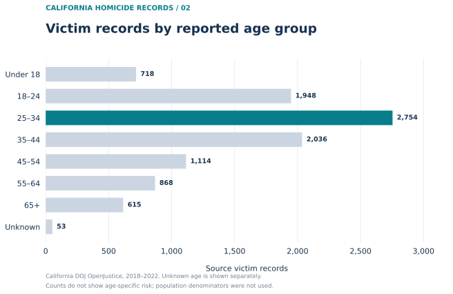
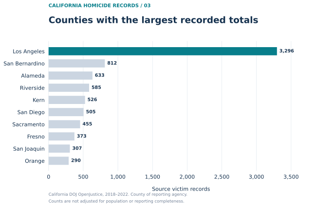

# California Homicide Analysis (2018–2022)

**Research analyst portfolio project | Python · pandas · Matplotlib · data validation**

[](https://github.com/ismael-soto-jr/california-homicide-analysis/actions/workflows/test.yml)

## Project overview

How do recorded homicide victim counts vary across years, reported age groups, and California counties—and how can we make those descriptive results auditable?

I developed a Python workflow to clean, validate, and summarize a **historical California Department of Justice (DOJ) OpenJustice homicide extract** downloaded in August 2023. The project emphasizes careful data preparation, defensible interpretation, automated checks, and reproducible tables and visualizations.

**Scope:** 10,106 source victim records coded as actual/willful homicide, with incident (assault) years 2018–2022, across 56 counties represented in the extract.

> **Interpretation:** These are **source victim-record counts**, not verified unique incidents, population-adjusted homicide rates, or estimates of causal effects. A reporting-format transition in 2021–2022 limits direct comparisons over time.

## Key descriptive findings

| Question | Finding | Important qualification |
| --- | --- | --- |
| Which year has the most records? | **2021: 2,338 records** | Yearly counts are affected by reporting-system changes |
| Which broad age group has the most records? | **Ages 25–34: 2,754 records (27.3%)** | Larger counts do not establish greater age-specific risk |
| Which county has the most records? | **Los Angeles County: 3,296 records (32.6%)** | County populations and reporting completeness are not adjusted for |

These figures summarize the **frozen 2018–2022 historical extract**, not current California homicide conditions. See the [full findings and cautions](reports/exploratory_findings.md).

**Additional descriptive analysis:** In this sample, the 18–44 age bands account for **66.67%** of records, while the ten counties with the largest totals account for **77.00%**. These are *shares of source records*, not population-adjusted risks. See the [composition analysis](reports/composition_findings.md) and its [reproducible metrics](reports/composition_metrics.csv).

## Visualizations

### 1. Records by incident year


The highest observed count in this extract is in 2021. The incident date refers to the **assault**, not necessarily the date of death.

### 2. Records by reported age group



Ages 25–34 make up the largest broad category. Unknown ages are retained as a separate group instead of being silently excluded.

### 3. Counties with the largest recorded totals



Los Angeles County has the largest absolute count. The county field describes the **county of the reporting agency**; counts are not adjusted for population.

The underlying [annual](reports/annual_counts.csv), [age-group](reports/age_group_counts.csv), and [county](reports/county_counts.csv) summary tables are included so results can be inspected without access to the archived source files.

## What the workflow demonstrates

- **Data cleaning:** Select study years and relevant crime-status codes; create consistent date and age-group variables while retaining source-row provenance.
- **Data quality and research judgment:** Preserve six ambiguous exact source-row matches rather than assuming they represent duplicate people; distinguish unknown age codes from infant codes.
- **Validated merging:** Correct a documented county crosswalk issue (code 54 = Tulare County; code 16 = Kings County) and enforce a many-to-one merge to prevent row multiplication.
- **Reproducibility:** Check expected record counts, annual totals, dates, county labels, and county mappings; generate summary tables and charts directly from prepared data.
- **Testing:** Maintain **eight automated tests**, including synthetic examples that do not need the original source data. GitHub Actions runs the tests and a data-free demonstration.

## Reproduce the project

This repository intentionally **does not include the original individual-level CSV or county reference workbook**. There are two ways to run the code:

### A. Public, data-free demonstration

Requires Python and access to this repository, but **no archived DOJ inputs**:

```bash
python3 -m venv .venv
source .venv/bin/activate   # macOS / Linux
python -m pip install -r requirements.txt

python -m pytest -q
python examples/synthetic_demo.py
python scripts/build_figures.py --from-summaries
python scripts/analyze_summaries.py --check
```

This runs synthetic tests and a demonstration of the preparation functions, then regenerates the figures from the published aggregate tables. **It does not independently reconstruct the original individual-level dataset.**

### B. Full historical-data rebuild

If you have the exact archived inputs, place them under `data/raw/` with these filenames:

- `HomicideActuals1987-2022.csv`
- `NCIC Code Jurisdiction List_04242023.xlsx`

Then run:

```bash
python prepare_homicides.py
python scripts/build_figures.py
```

The first script validates the source and writes `data/processed/homicide_clean.csv`; the second generates the three CSV summaries and the SVG/PNG figures. The exact historical records must pass the built-in audit checks.

The workflow has been run locally with **Python 3.14.10**; GitHub Actions tests it with **Python 3.11**. See [source availability and reproducibility](docs/data_access.md) for why a current DOJ download may not reproduce the historical extract.

## Repository guide

| Location | Contents |
| --- | --- |
| [`prepare_homicides.py`](prepare_homicides.py) | Source validation, cleaning, county merge, and analysis-ready export |
| [`scripts/build_figures.py`](scripts/build_figures.py) | Aggregate tables and publication figures |
| [`tests/`](tests/) | Automated regression and summary checks |
| [`examples/synthetic_demo.py`](examples/synthetic_demo.py) | Invented-data demonstration of the real preparation functions |
| [`reports/`](reports/) | Audited aggregate CSVs, descriptive findings, and validation notes |
| [`figures/`](figures/) | SVG and PNG visualizations |
| [`docs/source_codebook.md`](docs/source_codebook.md) | Historical source definitions and coding decisions |
| [`docs/data_access.md`](docs/data_access.md) | Source provenance, access, and limits to open reproducibility |

## Methodological limitations

- Each row represents a **source homicide victim record**, which may not map one-to-one to a unique person or incident.
- The recorded incident date is the **assault date**; it is not necessarily the death date.
- DOJ's 2021–2022 reporting changes constrain comparisons across years.
- Raw county and age-group totals do **not** measure risk: population denominators, potential reporting differences, and other relevant factors are not accounted for.
- The source combines race and Hispanic ethnicity codes; the project does not create unsupported demographic categories or make causal claims.

For details, consult the [source codebook notes](docs/source_codebook.md), [validation notes](reports/validation_results.md), and [interpretive findings](reports/exploratory_findings.md).

## Exploratory county-year population adjustment (in development)

A [separate, validated Python workflow](scripts/county_record_ratios.py) is available for matching source victim-record counts to **county-year July 1 resident population estimates**. This extension requires an external, verified **58-county × five-year** population file. The output is intentionally kept local and **no resulting county-year ratios, rankings, or risk claims have been published**.

See the [population-denominator instructions and reporting cautions](docs/population_denominators.md). The eight existing regression and summary tests are supplemented by seven synthetic tests for population validation and county-year joins.

**Published-source reconciliation:** A separate [58-county, five-year DOJ Table 14 reference](reports/doj_published_table14_county_year.csv) can now be checked against the archived sample using [reconciliation code](scripts/reconcile_doj_publication.py). The published report totals **10,187** known-victim homicide crimes versus **10,106** archived source rows; differences have **not** been resolved or corrected. See the [methodological reconciliation note](docs/doj_publication_reconciliation.md). The reference CSV and its validation can be reproduced without the original individual-level source files.

## Next research directions

Potential extensions include carefully matched population denominators for county-level rates, greater scrutiny of reporting-system changes, and additional descriptive variables after validating their source coding. These are **planned directions**, not analyses currently completed here.

---

**Author:** Ismael Soto Jr. · Master of Public Policy and Graduate Certificate in Applied Data Science, UC Berkeley.
